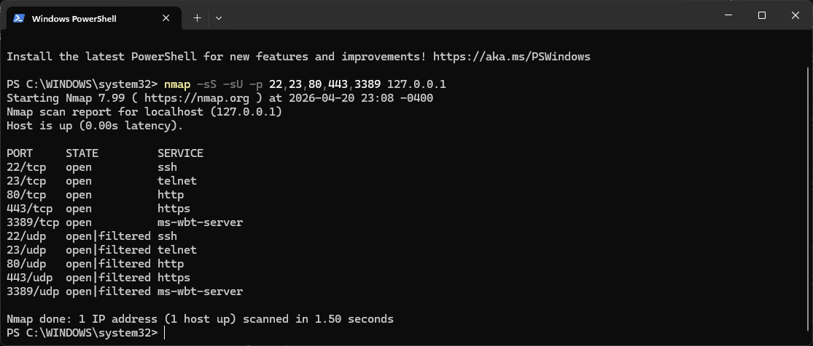
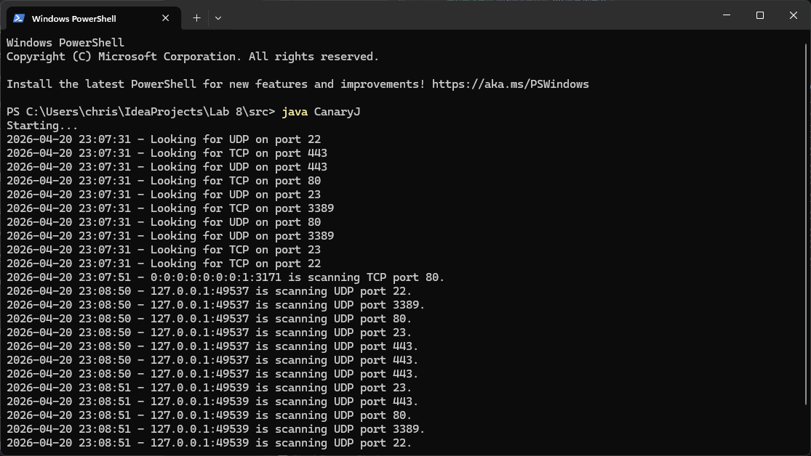
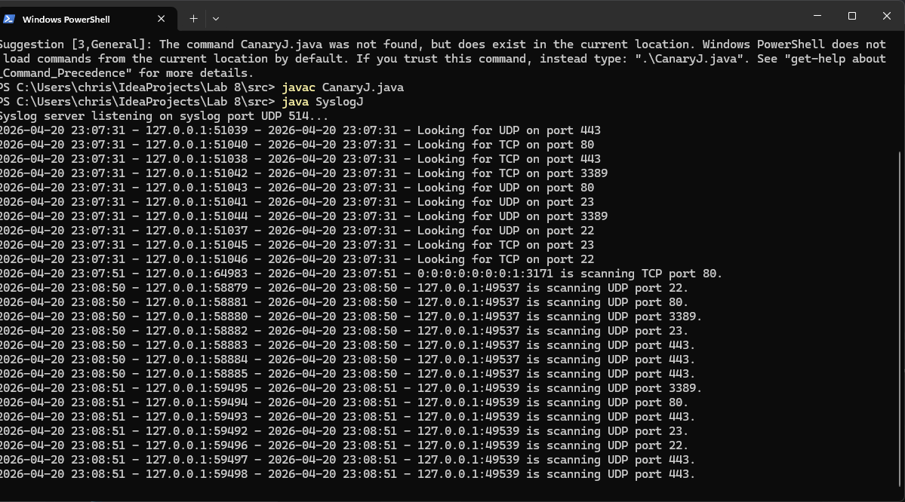
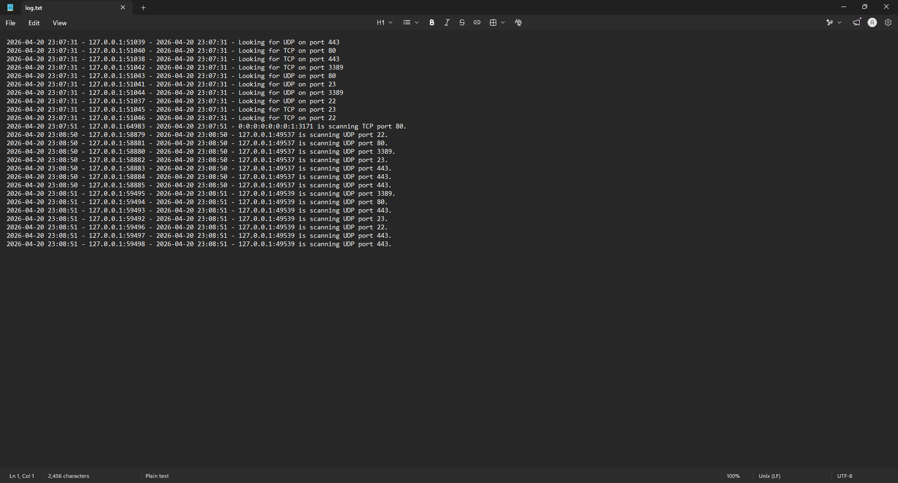

# Port Scan Canary

A lightweight, dependency-free intrusion detection pair written in Java:

- **CanaryJ** opens decoy TCP and UDP listeners on ports attackers commonly probe (SSH, Telnet, HTTP, HTTPS, RDP by default). Any connection or datagram that reaches one is reported as a scan, with the source IP and port, the protocol and port hit, and a timestamp.
- **SyslogJ** is a minimal UDP syslog collector. CanaryJ forwards every alert to it, and it prints and appends them to a log file, decoding standard syslog facility and severity.

Together they form a small detection pipeline: a canary on the host being watched, and a central log server collecting its alerts, the same shape as a honeypot feeding a SIEM.

```
  attacker / scanner            monitored host                 log server
 ┌──────────────────┐   probe   ┌─────────────────┐  UDP 514   ┌──────────────────┐
 │ nmap -sT -sU ... │ ────────▶ │     CanaryJ     │ ─────────▶ │     SyslogJ      │
 └──────────────────┘           │ decoy listeners │  <36>...   │ console + log.txt│
                                └─────────────────┘            └──────────────────┘
```

Built for CS477 Network Security (Iona University, Spring 2026) and extended afterwards.

## Features

**CanaryJ**
- Multithreaded: one blocking listener thread per port and protocol.
- Skips any port already bound by a real service instead of failing or hijacking it.
- Ports and protocols configurable on the command line or from a params file.
- Thread-safe output: listener threads only enqueue events on a `LinkedBlockingQueue`; a single writer thread prints and forwards them, so messages never interleave.
- Forwards alerts as RFC 3164-style syslog over UDP, UTF-8 encoded (`<36>` = auth.warning for scans, `<38>` = auth.info for status). Works with SyslogJ or any standard collector such as rsyslog.
- Refuses to listen on its own syslog destination port, which would otherwise create an alert feedback loop.

**SyslogJ**
- Records sender address, receive time (to the second) and message for every datagram.
- Appends to a UTF-8 log file and flushes after each message.
- Decodes the `<PRI>` header into facility and severity, e.g. `[auth.warning]`.
- Configurable listen port and log file.

## Quick start

Requires Java 17 or newer. Prebuilt jars are attached to the releases, or build them yourself:

```bash
mkdir -p build
javac --release 17 -d build src/*.java
jar --create --file CanaryJ.jar --main-class CanaryJ -C build . 
jar --create --file SyslogJ.jar --main-class SyslogJ -C build .
```

In one terminal, start the collector. Ports below 1024 need administrator/root rights, so for a quick local test use a high port:

```bash
java -jar SyslogJ.jar --port 5514 --log scans.log
```

In another, start the canary and point it at the collector:

```bash
java -jar CanaryJ.jar --syslog 127.0.0.1:5514
```

Then scan it from a third terminal (only scan machines you own or have permission to scan):

```bash
nmap -sT -sU -p 22,23,80,443,3389 127.0.0.1
```

## Usage

```
java -jar CanaryJ.jar [--syslog host[:port] | --no-syslog] [tcp PORT...] [udp PORT...]
java -jar CanaryJ.jar [--syslog host[:port] | --no-syslog] params.in

java -jar SyslogJ.jar [--port PORT] [--log FILE]
```

| Example | What it does |
|---|---|
| `java -jar CanaryJ.jar` | TCP and UDP 22, 23, 80, 443, 3389; forwards to `127.0.0.1:514` |
| `java -jar CanaryJ.jar tcp 21 22 8080 udp 53 161` | Custom ports |
| `java -jar CanaryJ.jar --syslog 10.0.20.5 tcp 22` | Forward to a remote collector |
| `java -jar CanaryJ.jar --no-syslog` | Console only |
| `java -jar CanaryJ.jar examples/params.in` | Read options from a file |

A params file holds the same tokens separated by spaces or new lines, with `#` comments. Options given on the command line override the file. See [`examples/params.in`](examples/params.in).

## Sample output

CanaryJ:
```
2026-11-05 20:23:01 - Listening on TCP port 2222
2026-11-05 20:23:03 - 127.0.0.1:39852 is scanning TCP port 2222.
2026-11-05 20:23:03 - 127.0.0.1:60074 is scanning UDP port 5353.
```

SyslogJ (received time, sender, decoded priority, message):
```
2026-11-05 20:23:03 - 127.0.0.1:41751 - [auth.warning] CanaryJ: 2026-11-05 20:23:03 - 127.0.0.1:39852 is scanning TCP port 2222.
```

## Testing in the lab

The original version was tested on Windows against an nmap TCP SYN and UDP scan of localhost.

| nmap scan | CanaryJ alerts |
|---|---|
|  |  |

| SyslogJ console | SyslogJ log file |
|---|---|
|  |  |

## What I learned

**Connect scans and SYN scans look different to an application.** In the test above, nmap ran with `-sS`, a half-open SYN scan. CanaryJ caught every UDP probe but almost none of the TCP ones. A SYN scan sends a SYN, gets a SYN-ACK from the kernel, then sends a RST instead of completing the handshake. The connection never reaches the application's `accept()` call, so a user-space listener never sees it. A full connect scan (`-sT`) completes the handshake and is detected every time.

That is a real limitation of socket-level canaries: catching stealth scans needs packet-level visibility, such as a raw socket or pcap capture, a host firewall logging rule, or a network IDS like Snort, Suricata or Zeek. It's also why many honeypots run behind packet capture rather than relying only on listening sockets.

**Concurrency needs a single owner for shared output.** With ten listener threads writing to the console and a socket at once, output can interleave. Funneling events through a queue to one writer thread fixed this without locks scattered through the code.

**UDP detection is noisy and spoofable.** Since UDP has no handshake, the source address in a probe can be forged. TCP connect alerts are much more trustworthy about who is scanning.

## Disclaimer

This is for education and for monitoring networks you own or are authorized to monitor. Only run scans against systems you have permission to scan.
